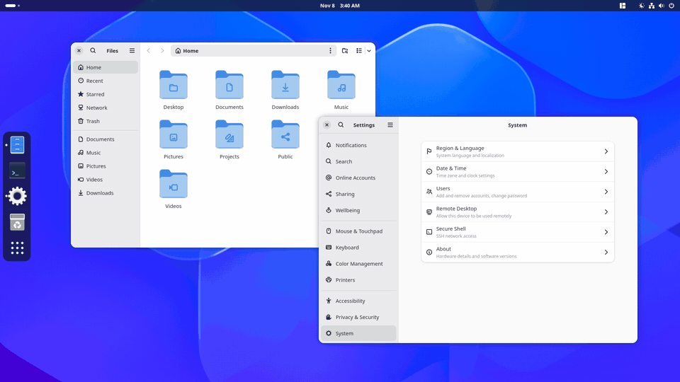

# Smooth Overview

   

A GNOME Shell extension that lets the overview fill the screen behind a fixed dock.

With Dash to Dock (or another dock) set to stay visible, GNOME sizes the overview to the space beside the dock. The wallpaper is cut off at the dock's edge, and the workspaces jump sideways as the overview opens. GNOME also centres the top bar's clock in the space beside the dock rather than on the screen.

Smooth Overview makes both use the whole screen below the top bar instead. Window placement doesn't change: windows still maximize and tile around the dock (unless you turn on the maximize setting below).



*The overview opening and closing with a floating dock on the left, at half speed. The workspace stays centred on the whole screen.*

## How it works

The overview and the top bar ask GNOME Shell for the monitor's *work area* (the screen minus panels and docks). Smooth Overview answers those requests from the overview's files (`workspace.js`, `overviewControls.js`) and the top bar (`panel.js`) with the monitor minus the top bar. Dash to Dock's own overview adjustments (which would otherwise push the search box over by the dock's width) are treated the same way. Every other caller, including Dash to Dock placing the dock itself, gets the real work area. Turning the extension on or off takes effect immediately; no logout needed.

Supports GNOME Shell 49, 50 and 51.

## Settings

**Only when the dock is floating** (on by default). When on, Smooth Overview only steps in while Dash to Dock (or Ubuntu Dock) shows a dock that stops short of the screen edges, that is, not in "panel mode" (extend-height); with an edge-to-edge dock it changes nothing. When off, Smooth Overview is always on. It follows the setting and the dock's own settings live. If neither dock is running, the switch is greyed out and Smooth Overview stays on.

**Maximized windows cover a floating dock** (off by default). While the dock floats, a maximized window (the Maximize button, the titlebar menu, a double-click on the titlebar) fills the screen below the top bar, covering the dock and its gaps, and the dock slides away until the pointer is pushed against its edge. New windows still open beside the dock: one that would start partly under it is moved clear (and shrunk only if it's too big to fit). Tiling Shell's tiles keep exactly the area beside the dock they have today, and fullscreen and edge-to-edge docks don't change. To do this, Smooth Overview takes over four of Dash to Dock's settings while the dock floats (`dock-fixed` off, `intellihide` on in maximized-windows mode, `autohide` on), and puts your own values back when the dock stops floating or the switch is turned off. Changes made to those four settings in the meantime are kept and put back too.

**With Dash to Panel**, Smooth Overview steps aside whatever the setting: Dash to Panel replaces the top bar with a taskbar that always reserves its edge, and GNOME's own overview already fits it exactly.

## Install

From a checkout:

```bash
gnome-extensions pack --force .
gnome-extensions install --force smooth-overview@redfoxlabs.tech.shell-extension.zip
```

Then log out and back in (GNOME only finds newly installed extensions at login), and turn it on in Extensions.

## License

GPL-2.0-or-later. See [LICENSE](LICENSE).
